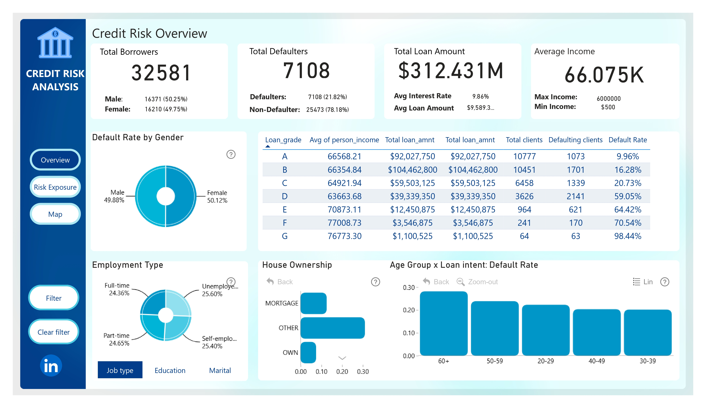
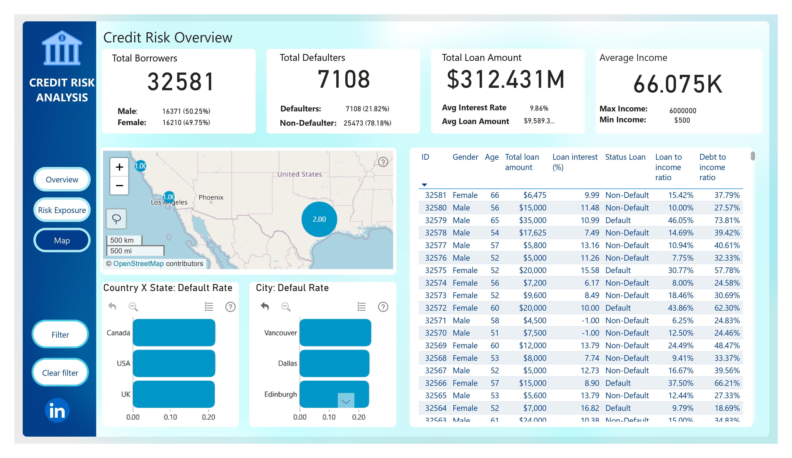

# 📊 Credit Risk Analysis Dashboard
Interactive Dashboard Link: https://app.powerbi.com/view?r=eyJrIjoiZDMwOTA0MWQtMGUxNS00ZGJkLTg1MTUtYzRmMjE0YjI3MDE3IiwidCI6IjQ2NTRiNmYxLTBlNDctNDU3OS1hOGExLTAyZmU5ZDk0M2M3YiIsImMiOjl9

## 👤 Authors & Contributions
**Lường Quốc Hùng (IT Business Analyst / UI Designer):** Gathered credit business requirements, established the Risk Segmentation Framework, designed drill-down logic connecting behavioral/financial variables, and extracted actionable Business Insights from the data to support decision-making.
**[Hiep Dylan] (Data Analyst):** Processed and cleaned raw data, built the Data Model, developed advanced DAX functions, and implemented data visualization on Power BI.

Example: Individuals with less than one year of work experience have the highest default rate (27.94%). When clicking on the “<1 year” column in the chart, we can further drill down into the data as follows. Within this group (<1 YOE), at the time of the loan, unemployed individuals have the highest default rate (27.94%). They typically borrow for medical expenses or debt consolidation. If we only analyze Job Type in isolation, we would not uncover this insight! (Dashboard page 1)

## 📌 Business Overview
The bank faces significant credit risk from personal loans. This project analyzes a dataset of **32,581 loan records** with an estimated total exposure of **$312M**. The current Default Rate is relatively high at **21.82%**, requiring a multi-dimensional analysis framework to optimize the credit risk assessment process and portfolio management.

---

## 🎯 Business Objectives
**Portfolio Analysis:** Evaluate the distribution of loans across various customer segments.
**Key Drivers Identification:** Determine the critical factors directly influencing the default rate.
**Framework Development:** Develop a risk segmentation framework (Low, Medium, High) based on financial indicators (DTI, LTI) and borrower behavior.
**Dashboard Design:** Outline an interactive dashboard system to help Risk Managers easily monitor and conduct exploratory analysis.
---

## 📂 Dataset

The dataset includes borrower demographics, financial indicators, and loan-related attributes, such as:

* Income, employment type, and home ownership
* Loan amount, interest rate, and loan term
* Debt-to-income ratio and credit utilization
* Past delinquencies and default history

---

## 📊 Key Metrics

* Total Loan Amount
* Default Rate
* Average Loan Amount
* Debt-to-Income Ratio (DTI)
* Loan-to-Income Ratio (LTI)

---

## ⚙️ Risk Segmentation Framework & Business Logic
To evaluate borrower risk effectively, I established a risk stratification framework based on the Debt-to-Income (DTI) and Loan-to-Income (LTI) ratios:
*   **Low Risk (<20%):** Lowest risk, strong repayment capability.
*   **Medium Risk (20–40%):** Moderate risk, can be approved but requires monitoring.
*   **High Risk (41–60%):** High risk, warning of financial burden.
*   **Very High Risk (>60%):** Highest risk, imminent danger of default.

---

## 📸 Dashboard Previews & Key Insights

### 1. Credit Risk Overview

*   **Overall Risk:** The dataset includes 32,581 borrowers with ~$312M total exposure. 7,108 borrowers (21.82%) have defaulted.
*   **Demographics:** Default rates show no significant differences across gender (~50.25% Male / ~49.75% Female). However, the **60+ age group** exhibits the highest default rate.
*   **Loan Grade:** Grades A–C account for a large portion of total loan volume. Lower grades (D–G) represent extreme default risk.

### 2. Risk Exposure & Behavior Analysis

*   **Loan Intent:** Debt Consolidation, Medical, and Home-related loans account for the highest proportions. High-frequency categories may indicate structural demand, but also potential concentration of risk.
*   **Employment Stability (Years of Experience):** Default rate is highest for `< 1 year experience` or `Unknown` and decreases as experience increases. Employment stability is a clear driver of risk.
*   **Default History:** 67.27% of borrowers have defaulted before. Past default behavior is a strong predictor of future default, confirming that credit history is one of the most important risk indicators.

*   **Debt-to-Income (DTI) & Loan-to-Income (LTI):** There is a strong positive relationship between debt burden and default risk. Very High ratios (>60%) indicate the highest likelihood of default.
*   **Interest Rate & Loan Grade:** Default rate increases sharply from Grade A to G (nearly 100% default rate for G). The very high interest group (>16%) shows a significantly higher default rate.
*   **Past Delinquencies:** Borrowers with major past delinquencies show higher default rates than "clean" profiles. Even before default happens, repayment issues are already visible.

### 3. Geographic Risk Distribution

*   Default rates do not vary drastically across macro-regions. However, **Canada** ranks highest, followed by the USA and the UK.
*   At the city level, **Vancouver (Canada)** has the highest default rate among all locations.

---

## 🛠 Tools & Technologies
*   **Business Analysis Core:** Risk Segmentation Framework, Requirements Analysis, Drill-down Logic Design, Dashboard UI/UX Wireframing.
*   **Data Execution (By Data Analyst):** Power BI, DAX (Data Analysis Expressions), Data Modeling & Visualization.

---

